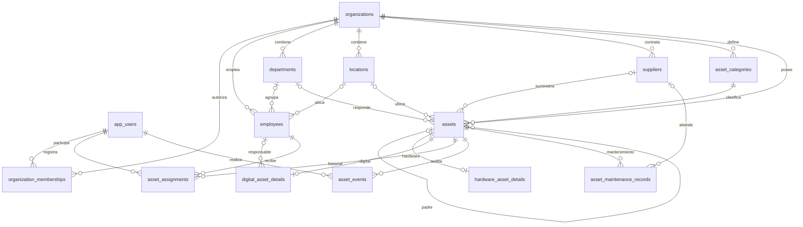

# AMS · Asset Management System

El registro de activos incluye categorías iniciales por empresa, creación de categorías propias y custodia empresarial o responsable opcional. Consulta [docs/CATEGORIES_CUSTODY.md](docs/CATEGORIES_CUSTODY.md).

Las empresas pueden crear, renombrar, desactivar y reactivar sus propias áreas y ubicaciones desde el menú lateral. Consulta [docs/AREAS_LOCATIONS.md](docs/AREAS_LOCATIONS.md).

La actualización de temas por organización, filtros históricos y etiquetas QR está documentada en [docs/BRANDING_FILTERS_QR.md](docs/BRANDING_FILTERS_QR.md). Edinun tiene una organización y un tema propios; las demás empresas conservan su identidad genérica o personalizada.

MVP de inventario de tecnología para varias empresas: hardware, licencias y servicios digitales, empleados, entregas, devoluciones, transferencias, vida útil, alertas, auditoría y exportación CSV. La interfaz está en español y utiliza la API y PostgreSQL para todas las operaciones.

## Inicio local

Requiere Docker Desktop con motor Linux activo y Docker Compose **2.24.4 o posterior** (el archivo de producción usa `!reset`). No necesitas instalar Java, Node ni PostgreSQL para ejecutar los contenedores.

Desde la raíz del repositorio, en PowerShell:

```powershell
Copy-Item .env.example .env
notepad .env
# Completar DB_PASSWORD y DEMO_PASSWORD con valores propios.
# DEMO_PASSWORD: mínimo 12 caracteres, máximo 72 bytes UTF-8.
docker compose up --build -d
docker compose ps
```

En Linux/macOS, utiliza `cp .env.example .env` y tu editor. No subas `.env` al repositorio. Compose rechaza una contraseña de base vacía y el seed rechaza una contraseña de demostración corta.

| Servicio | Acceso local |
| --- | --- |
| Aplicación | http://localhost:3000 |
| API a través de Nginx | http://localhost:3000/api/v1 |
| Swagger de desarrollo | http://localhost:8080/swagger-ui.html |
| OpenAPI | http://localhost:8080/v3/api-docs |
| Salud | http://localhost:8080/actuator/health |
| PostgreSQL para DBeaver | localhost:5432, base `ams`, usuario de `.env` |

La cuenta de desarrollo usa `DEMO_EMAIL` (por defecto `admin@demo.local`) y la contraseña que hayas definido en `DEMO_PASSWORD`. No hay una contraseña fija en el código. El seed solo se ejecuta con perfil `dev` y `DEMO_ENABLED=true`. Genera una empresa, 6 empleados, 27 categorías y 19 activos, incluyendo 8 asignados, mantenimiento y alertas. Es idempotente; no repite registros ni reinicia contraseñas en cada arranque.

Para detener conservando datos:

```powershell
docker compose down
docker compose up -d
```

El volumen `postgres_data` conserva el inventario. `docker compose down -v` elimina ese volumen; no lo utilices para un reinicio normal.

## Arquitectura y estructura

Monolito modular Spring Boot 4.1.1, Java 21, Maven, Spring MVC, Security, JPA/Hibernate y JdbcTemplate para consultas y catálogos. PostgreSQL es la fuente de datos. Flyway es el único responsable del esquema; Hibernate valida al iniciar. Se conserva el backend Maven original en la raíz para no duplicarlo o mover archivos innecesariamente.

React 19 + TypeScript + Vite, Tailwind CSS 4, React Router, TanStack Query, React Hook Form, Zod y Lucide. Nginx sirve la aplicación y reenvía `/api` al backend. Los contenedores se comunican mediante los nombres `db` y `backend`.

```text
src/main/java/com/assetmanager/
  asset/          Entidad, repositorio JPA, DTO, inventario y vida útil
  assignment/     Entrega, devolución, transferencia e historial
  audit/          Eventos de activos
  dashboard/      Consultas agregadas por organización
  identity/       Sesiones, CSRF, roles y aprovisionamiento
  organization/   Empresas, empleados, catálogos y seed de desarrollo
  shared/         Errores, JSON y normalización de fechas
src/main/resources/db/migration/
src/test/java/com/assetmanager/
frontend/src/
  components/ features/ hooks/ pages/ services/ types/
Dockerfile
frontend/Dockerfile
frontend/nginx.conf
docker-compose.yml
docker-compose.production.yml
docs/MANUAL_TESTS.md
DEVELOPMENT_PLAN.md
```

Hardware y activos digitales usan DTO separados dentro de un DTO común y tablas especializadas; se agrupan en el módulo `asset` hasta que su complejidad justifique más paquetes. Los catálogos y empleados comparten infraestructura en `organization`. La tabla de mantenimiento prepara una ampliación futura; en este MVP se gestiona su estado administrativo.

## Seguridad y reglas de negocio

- Contraseñas con BCrypt, sesiones de servidor y cookie `JSESSIONID` HttpOnly, SameSite=Lax y Secure configurable. Cambia el identificador de sesión al autenticar. Las sesiones actuales viven en memoria: un reinicio del backend requiere iniciar sesión otra vez.
- CSRF también protege login y logout. Antes de modificar datos, obtener `GET /api/v1/auth/csrf` y enviar el token en `X-CSRF-TOKEN`, conservando la cookie. Obtener un token nuevo después del login. El frontend hace esto automáticamente.
- `ORG_ADMIN` administra su empresa y autoriza cuentas; `ASSET_MANAGER` administra inventario y catálogos; `VIEWER` consulta y exporta. `system_admin` identifica al **administrador maestro** y concede acceso global a todas las empresas activas y a la administración del sistema. Las cuentas normales siguen limitadas a sus membresías.
- Cada solicitud verifica cuenta activa, membresía y organización. Las referencias cruzadas utilizan claves foráneas compuestas `(organization_id,id)` y comprobaciones de servicio. No se confía en roles enviados por el cliente.
- Códigos únicos por empresa, UUID, importes `BigDecimal`/`numeric(19,2)`, fechas y costos validados, asignación solo a empleados activos de la empresa.
- Bloqueo pesimista del activo + transacción + índice único parcial de asignación vigente. La transferencia cierra y abre movimientos atómicamente. Relaciones padre/hijo comprobadas contra ciclos y cambios serializados por empresa.
- No hay eliminación física de activos. La baja cambia el estado y conserva movimientos y auditoría. Empleados y catálogos se desactivan; no se desactiva a un empleado con entregas vigentes.
- Vida útil = fecha de servicio + meses de calendario. Los días restantes se limitan a cero y el porcentaje a 0–100. Los datos faltantes producen `NOT_CALCULABLE`. Superar la vida útil no cambia automáticamente el estado administrativo. La garantía tiene su propia fecha.
- Timestamps en UTC y fechas de calendario sin conversión horaria. La interfaz presenta timestamps en la zona del navegador. La moneda se conserva por activo; no se suman monedas diferentes en un indicador monetario.
- No se solicitan claves de producto, contraseñas ni tokens de proveedores. Las referencias contractuales deben ser públicas o no secretas. La auditoría registra cambios relevantes del activo y responsables; no registra credenciales.

## Uso de la aplicación

**Administración maestra:** consulta [docs/MASTER_ADMIN.md](docs/MASTER_ADMIN.md) para crear una cuenta global independiente con `MASTER_ENABLED`, `MASTER_EMAIL` y `MASTER_PASSWORD`. Su panel en `/system` permite gestionar todas las organizaciones, usuarios y accesos; las cuentas normales siguen aisladas por empresa.

1. Inicia sesión y selecciona tu empresa en la barra lateral.
2. En Inventario, pulsa **Registrar activo** y selecciona hardware o digital. Registra primero categorías, empleados, ubicaciones o proveedores si trabajas sin los datos de demostración.
3. Introduce código, nombre y categoría. Para hardware, los datos de CPU/RAM/SO son opcionales. Agrega fechas, vida útil en meses y ubicación. Puedes asignarlo a un empleado al crearlo.
4. **Continuar registrando otro activo** limpia el registro y conserva categoría y ubicación para facilitar el levantamiento.
5. En la ficha del activo, consulta vida útil, historial y responsable. Asigna, transfiere o registra devolución con una fecha. Devuelve un equipo antes de enviarlo a mantenimiento o darlo de baja.
6. En Empleados, abre la ficha para ver sus equipos y entregas anteriores. Un empleado no necesita cuenta de acceso.
7. En Reportes, usa presets y filtros por categoría, estado, empleado, departamento y ubicación. Exportar descarga todos los resultados filtrados en CSV UTF-8 con BOM, escape de celdas y protección contra fórmulas de hoja de cálculo.
8. Configuración permite administrar categorías y, al administrador, autorizar usuarios existentes o nuevos para la empresa con un rol específico.

## Variables de entorno

| Variable | Función |
| --- | --- |
| `DB_USER`, `DB_PASSWORD` | Usuario y contraseña de PostgreSQL |
| `DATABASE_URL` | URL JDBC para ejecución fuera de Compose; Compose usa `db:5432/ams` |
| `SPRING_PROFILES_ACTIVE` | `dev` para desarrollo; `prod` en la superposición de producción |
| `DEMO_ENABLED`, `DEMO_EMAIL`, `DEMO_PASSWORD` | Habilitación y credenciales del seed exclusivo de desarrollo |
| `COOKIE_SECURE` | `false` para HTTP local, `true` con HTTPS |
| `API_DOCS_ENABLED` | Publicación de Swagger y OpenAPI |
| `LIFECYCLE_ALERT_MONTHS` | Horizonte de aviso de vida útil (6 por defecto) |
| `MASTER_ENABLED`, `MASTER_EMAIL`, `MASTER_PASSWORD` | Aprovisionamiento de cuenta maestra independiente con acceso global; ver `docs/MASTER_ADMIN.md` |
| `BOOTSTRAP_ENABLED` | Aprovisionar una instalación nueva sin datos de demostración |
| `BOOTSTRAP_EMAIL`, `BOOTSTRAP_PASSWORD`, `BOOTSTRAP_ORGANIZATION` | Cuenta y empresa iniciales de una instalación vacía |

Los avisos de licencias y garantías cubren los próximos 30 días. El horizonte de vida útil puede configurarse; la etiqueta del dashboard usa el valor inicial de seis meses.

## API

Base: `/api/v1`. En las rutas siguientes, `O` es un UUID de organización autorizada y `A` un UUID de activo.

| Métodos | Ruta | Operación |
| --- | --- | --- |
| GET | `/auth/csrf` | Token de protección CSRF |
| POST | `/auth/login`, `/auth/logout` | Abrir/cerrar sesión |
| GET | `/auth/me` | Cuenta y empresas autorizadas |
| GET, POST | `/organizations` | Empresas autorizadas / crear empresa como administrador del sistema |
| GET, PUT | `/organizations/O` | Datos de empresa |
| GET, POST | `/organizations/O/users` | Consultar/autorizar cuentas como ORG_ADMIN |
| GET, POST | `/organizations/O/employees` | Listar/crear empleados |
| GET, PUT, DELETE | `/organizations/O/employees/{id}` | Ficha/actualización/desactivación |
| GET, POST | `/organizations/O/{departments\|locations\|suppliers\|categories}` | Catálogos |
| GET, PUT, DELETE | `/organizations/O/{catalogo}/{id}` | Consultar/editar/desactivar |
| GET | `/organizations/O/assets` | Inventario general |
| GET, POST | `/organizations/O/hardware-assets`, `/organizations/O/digital-assets` | Listar/crear activos |
| GET, PUT | `/organizations/O/hardware-assets/A`, `/organizations/O/digital-assets/A` | Consultar/editar |
| GET | `/organizations/O/assets/A` | Detalle con vida útil y auditoría |
| PATCH | `/organizations/O/assets/A/status` | Estado administrativo, cuerpo `{ "status": "RETIRED" }` |
| POST | `/organizations/O/assets/A/assign`, `/transfer` | Entrega/transferencia |
| POST | `/organizations/O/assets/A/return` | Devolución |
| GET | `/organizations/O/assets/A/assignments` | Historial de entregas |
| GET | `/organizations/O/dashboard` | Indicadores y distribuciones |
| GET | `/organizations/O/assets/expiring?type=DIGITAL` | Alertas (`DIGITAL`, `WARRANTY`, `LIFECYCLE`) |
| GET | `/organizations/O/assets/export` | Exportación CSV filtrada |

Listas de inventario: `page=0`, `size=20` (máximo 100), `sort=name|assetCode|createdAt|status`, `direction=asc|desc`, `search`, `kind`, `status`, `categoryId`, `employeeId`, `departmentId`, `locationId`, `lifecycle=EXPIRING|EXCEEDED`, `expiry=DIGITAL|WARRANTY`. Los catálogos y empleados admiten `page`, `size`, `search`, `activeOnly`; usan orden alfabético estable. La selección de empleados carga todas las páginas de registros activos y permite búsqueda local.

Entrega y transferencia:

```json
{"employeeId":"UUID","departmentId":null,"assignedAt":"2026-10-16T14:00:00Z","expectedReturnAt":null,"notes":"Entrega de equipo"}
```

Devolución:

```json
{"returnedAt":"2026-10-16T15:00:00Z","notes":"Equipo completo"}
```

Respuestas: 201 al crear, 204 al cerrar sesión o desactivar, 400 para datos inválidos, 401 sin sesión, 403 sin permisos y 409 ante conflictos. Errores con `message` y, en validación de DTO, `fields`. No se serializan entidades JPA como respuesta. Las respuestas de consulta usan campos de base en `snake_case`; los DTO de escritura usan `camelCase`. Swagger contiene los esquemas de escritura.

## Migraciones y modelo de datos

`src/main/resources/db/migration/V1__initial_schema.sql` crea las 14 tablas y los índices iniciales. No cambies una migración aplicada; agrega `V2__...sql` para evolucionar el esquema. El historial de ejecución queda en `flyway_schema_history`. Los datos de desarrollo son un runner separado de las migraciones.



La relación de licencias admite `seats` y un responsable administrativo. No consume puestos mediante las asignaciones físicas: la asignación de puestos por usuario se reserva para otra fase. `residual_value` prepara una futura estimación de depreciación; el sistema no presenta depreciación contable oficial.

## Desarrollo y pruebas

Requiere JDK 21+, Maven 3.9+ y Node 22.20+. El wrapper Maven original se conserva. Si falla su descarga, utiliza Maven instalado.

```powershell
docker compose up -d db
$env:DB_PASSWORD = '<la contraseña local>'
$env:SPRING_PROFILES_ACTIVE = 'dev'
# Para datos de demostración fuera de Compose, definir además DEMO_ENABLED/EMAIL/PASSWORD.
./mvnw.cmd spring-boot:run
# Otra terminal:
cd frontend
npm ci
npm run dev
```

Vite sirve http://localhost:5173 y reenvía `/api` a localhost:8080.

```powershell
./mvnw.cmd test
cd frontend
npm test
npm run build
```

JUnit ejecuta pruebas unitarias de calendario, nulos y límites. `InventoryIntegrationTest` inicia PostgreSQL 17 mediante Testcontainers si Docker está disponible. Sin Docker, esa clase se omite explícitamente a menos que se configure una base **exclusiva de pruebas**:

```powershell
$env:AMS_TEST_DATABASE_URL='jdbc:postgresql://localhost:55432/ams_test'
$env:AMS_TEST_DATABASE_USER='postgres'
$env:AMS_TEST_DATABASE_PASSWORD='<contraseña de pruebas>'
mvn test
```

Las pruebas aplican Flyway y crean datos propios; no apuntarlas a producción. Comprueban persistencia, códigos por empresa, claves foráneas, costos, asignaciones concurrentes, devolución, transferencia, permisos, sesión/CSRF por HTTP, validaciones, exportación, Swagger y seed idempotente. Las pruebas de React comprueban login, validación, navegación y paginación. El recorrido manual completo está en [docs/MANUAL_TESTS.md](docs/MANUAL_TESTS.md).

Consulta [DEVELOPMENT_PLAN.md](DEVELOPMENT_PLAN.md) para los resultados de validación y límites pendientes de esta entrega.

## Problemas frecuentes

- **No se encuentra docker_engine**: inicia Docker Desktop y espera a que el motor Linux esté listo.
- **Backend no saludable**: `docker compose logs --tail=100 backend`; comprueba la contraseña, la conectividad a `db` y cualquier error de Flyway.
- **Puerto ocupado**: cambia el puerto del host en Compose; conserva los puertos internos y actualiza tu URL/DBeaver.
- **Error 403**: revisa membresía y rol; para llamadas manuales conserva cookie y token CSRF. Con HTTP local usa `COOKIE_SECURE=false`.
- **Demo no aparece**: se requiere perfil `dev`, `DEMO_ENABLED=true` y contraseña válida. No se vuelven a crear datos si la empresa ya existe.
- **Cambiar DB_PASSWORD tras el primer inicio**: la variable del contenedor no cambia la contraseña de un volumen existente. Cambia la contraseña dentro de PostgreSQL y actualiza la configuración de la aplicación.
- **Cambiar DEMO_PASSWORD tras el primer inicio**: no modifica una cuenta existente. El seed evita sobrescribir credenciales.
- **Flyway detecta checksum distinto**: restaura la migración original y agrega una migración nueva; no ejecutes `repair` sin revisar la causa.

## Preparación de producción y VPS

1. Usa una base/volumen vacío y credenciales externas propias. Establece `DEMO_ENABLED=false`, perfil `prod`, `COOKIE_SECURE=true`, `API_DOCS_ENABLED=false`.
2. Para la primera cuenta, define temporalmente `BOOTSTRAP_ENABLED=true`, `BOOTSTRAP_EMAIL`, `BOOTSTRAP_PASSWORD` y `BOOTSTRAP_ORGANIZATION`. Solo funciona si no existen usuarios. Después del primer arranque, desactiva bootstrap y elimina sus variables sensibles.
3. Ejecuta `docker compose -f docker-compose.yml -f docker-compose.production.yml up -d --build`. La superposición elimina puertos públicos de PostgreSQL y backend, desactiva demo y documentación y activa cookies Secure. El frontend queda enlazado a 127.0.0.1:3000.
4. Configura Caddy/Nginx del VPS con TLS frente a 127.0.0.1:3000, firewall y DNS. Usa el mismo origen para frontend y API. El backend corre como usuario no root y Actuator solo publica salud. Ninguna imagen contiene `.env`.
5. Define la política de backups, supervisión, actualizaciones de imágenes y rotación de credenciales antes de usar datos reales. Para sesiones compartidas y alta disponibilidad, añade Spring Session en una fase posterior.

Las imágenes usan etiquetas concretas. Esta entrega no despliega recursos externos ni publica un sitio en la nube.

## Respaldo y restauración

Genera backups fuera del volumen de datos y protege sus permisos. Para evitar corrupción binaria por redirección en versiones antiguas de PowerShell, crea el dump dentro del contenedor y cópialo:

```powershell
New-Item -ItemType Directory -Force backups
docker compose exec -T db sh -c 'pg_dump -U "$POSTGRES_USER" -d ams -Fc -f /tmp/ams.dump'
docker compose cp db:/tmp/ams.dump ./backups/ams.dump
```

Restaurar en una base de destino preparada y vacía; detén el backend durante la operación y verifica antes el destino:

```powershell
docker compose stop backend frontend
docker compose cp ./backups/ams.dump db:/tmp/ams.dump
docker compose exec -T db sh -c 'pg_restore -U "$POSTGRES_USER" -d ams --no-owner --exit-on-error /tmp/ams.dump'
docker compose start backend frontend
```

Para restaurar sobre datos existentes, prepara primero una base nueva o aplica una política explícita de reemplazo. Los comandos anteriores no eliminan tablas existentes automáticamente.

Referencias oficiales de compatibilidad: [Spring Boot 4.1.1](https://spring.io/blog/2026/08/20/spring-boot-4-1-1-available-now/), [documentación Spring Boot](https://docs.spring.io/spring-boot/reference/).

## Jenkins CI

Instalación local, credenciales GitHub/Telegram y demostración de las tres etapas: [GUIA_ENTREGA_JENKINS.md](GUIA_ENTREGA_JENKINS.md). Estado de comprobaciones reales: [ci/VALIDACION.md](ci/VALIDACION.md). Usa el Compose separado docker-compose.jenkins.yml; no reemplaza el despliegue de la aplicación.

Informe breve con capturas: [INFORME_JENKINS_MATEO_ORTEGA.docx](docs/INFORME_JENKINS_MATEO_ORTEGA.docx). Ejecuciones reales: #1 SUCCESS y #2 FAILURE controlado, con 46 pruebas aprobadas y notificación Telegram en cada caso.
